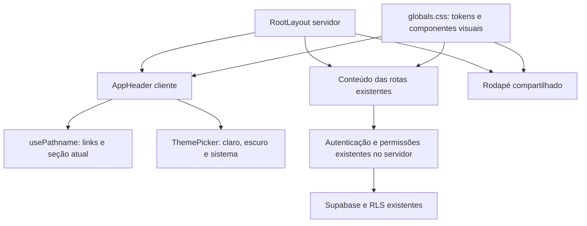

# ADR-018 — Identidade visual compartilhada

Data: 24/11/2026. Escopo confirmado pelo Dono do produto: melhorar o layout de toda a aplicação com referência ao GeoGuessr. Paleta e composição abaixo são escolhas técnicas locais, com aceite visual pendente.

## Contexto e decisão

As páginas usavam cartões/utilitários independentes, cabeçalho de navegação restrito ao painel e apresentação pública com referências antigas a setembro. Adotar uma base visual central em `globals.css`, com tokens de superfície/texto/borda/destaque nos dois temas e regras de apresentação para os componentes existentes. Preservar a paleta semântica dos gráficos e indicadores. A referência orienta o estilo esportivo e a hierarquia; a identidade continua GeoGuaras.

`RootLayout` continua servidor e inclui `AppHeader` como componente cliente. O cabeçalho usa somente `usePathname` para escolher navegação pública/interna e marcar seção atual. Não consulta sessão, não recebe dados pessoais e não concede acesso por reconhecer o caminho. Páginas/Server Actions/RLS continuam responsáveis por autenticação e autorização. O seletor de tema existente passa a compor o cabeçalho, com o script anterior de inicialização antes da hidratação. Conteúdo principal e rodapé permanecem irmãos no layout.

## Consequências

24/11/2026 — Complemento solicitado pelo Dono do produto: ferramenta local `web/scripts/preview-layout.mjs` renderiza páginas reais com dados sintéticos por SSR estático em servidor HTTP separado, restrito a `127.0.0.1:3100`. Supabase e ações substituídos somente dentro do carregador da prévia, sem mudança nas rotas de produção, credenciais ou autorização. GET/HEAD e CSP sem conexões externas/form action; navegação e tema disponíveis, operações e controles React apenas demonstrativos. Requer CSS de build atual. [Procedimento e evidências](../sprints/sprint-9-layout-geoguaras.md).

Uniformiza login, recuperação, painel e subpáginas sem duplicar consultas, criar novo backend ou acoplar navegação à sessão. Novas telas podem usar a mesma base. Estilos globais exigem homologação de formulários, tabelas e gráficos nas duas paletas, sobretudo componentes com cores utilitárias prévias. Mantidos alertas semânticos e foco visível. Sem nova biblioteca, fonte ou mídia externa; globo decorativo e marca em SVG do próprio código. Sem migração, alteração de dados, mudanças de SMTP/Auth ou impacto na renderização dos PDFs. Rollback somente da aplicação.

[Entrega, testes e limites](../sprints/sprint-9-layout-geoguaras.md).
