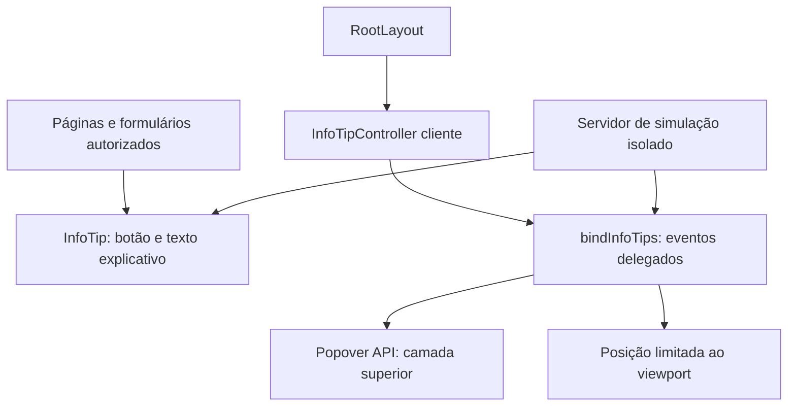

# ADR-019 — Ajuda contextual compartilhada

Data: 24/11/2026. Confirmado pelo Dono do produto: explicações em ícone “i”, por aproximação do mouse e toque em celular. Implementação local; aceite final pendente.

## Decisão e motivos

Posicionamento refinado pelo Dono do produto: ícone sempre à direita do título, rótulo ou controle correspondente. Usar grupos `info-heading` e `info-label` para alinhamento, sem inserir o botão de ajuda dentro de `<label>` ou de outro botão. Em textos longos, o texto pode quebrar mantendo o ícone ao lado; descrições da mesma seção podem ser reunidas no ícone do título.

Usar `InfoTip` para conteúdo explicativo complementar, mantendo estados, dados e confirmações visíveis. O HTML inclui botão com nome contextual, `aria-describedby`, ID único e conteúdo em `popover=auto`. Botões não enviam formulário. O popover entra na camada superior do navegador, evitando corte por cards, tabelas e regiões com overflow.

Controlador cliente único no layout delega eventos e posiciona o balão junto ao ponteiro, limitado ao viewport. Clique fixa, outro clique/Escape/fora fecha; foco dá acesso por teclado. Temporizador de saída permite alcançar o balão. Ajuda longa tem rolagem e pode receber foco. O módulo de eventos também é compilado para a simulação local, evitando uma segunda implementação de comportamento.

## Consequências e limites

Sem biblioteca, backend, persistência, permissão ou migração nova. Desktop usa mouse; celular usa toque; teclado mantém acesso. Textos originais continuam disponíveis. Não usar tooltip para erros, mensagens operacionais essenciais, dados principais, confirmações ou ações que exijam leitura antes de decidir. Conteúdo de ajuda deve ser predominantemente textual; controles de decisão permanecem na tela.

A camada superior depende de navegador com Popover API. Abertura por ponteiro e posicionamento dependem do JavaScript inicializado; sem ele existe o acionamento nativo por botão. Homologação real em smartphone e com leitor de tela permanece pendente. CSS/controle globais exigem cuidado em novas telas e com campos que usam `aria-describedby`.

[Escopo, testes e operação](../sprints/sprint-9-ajuda-contextual.md).
