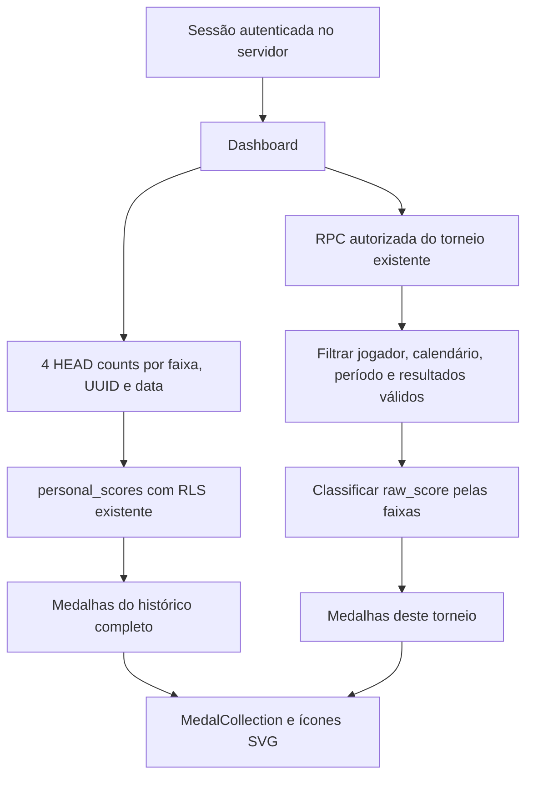

# ADR-020 — Medalhas derivadas dos resultados

Data: 24/11/2026. Confirmados pelo Dono do produto: duas coleções (torneio e histórico pessoal) e faixas bronze/prata/ouro/platina. Demais critérios abaixo são escolhas técnicas de implementação, com homologação pendente.

## Decisão

Derivar medalhas da pontuação absoluta de cada resultado, sem persistir concessões, criar eventos de premiação ou alterar o ranking. Regra central em `src/lib/medals.ts` e apresentação comum em `MedalCollection`. SVGs próprios e contadores com nomes acessíveis e ajuda contextual.

Na coleção do torneio, usar os dados existentes de `get_tournament_dashboard`: somente resultados válidos próprios, período/calendário/exclusões/elegibilidade e bruto aceito naquele contexto. Auditoria invalidada não concede medalha no torneio; coleção pessoal continua independente. Fechados usam os resultados preservados, sem reconstrução pelo histórico pessoal atual. Provisórios podem contar com aviso.

No pessoal, fazer quatro consultas de contagem exata via HEAD sobre `personal_scores`, filtradas por UUID da sessão, faixa e data até hoje. Evita depender dos 100 lançamentos recentes e baixar todo o histórico. Reaproveita cliente autenticado/RLS e não requer migração ou função privilegiada. Não somar coleções de torneios, pois o mesmo dia pode participar de vários.

## Consequências

Sem tabela/RPC/grant/credencial novo, escrita ou migração. Contadores acompanham correções e decisões existentes. Não é um inventário permanente de conquistas; alterações no resultado podem trocar/remover uma medalha. Coleção pessoal é privada do jogador da sessão; não são expostos totais de outros jogadores.

Quatro consultas HEAD adicionais por carregamento do painel, paralelas, com necessidade de sucesso integral. Falha não vira zero/parcial. Leituras independentes não são captura transacional; uma edição concorrente pode requerer atualização da página. Desempenho/integração remota ainda precisam de homologação. Não ampliar schema de métricas apenas para essa apresentação.

[Entrega, faixas e homologação](../sprints/sprint-9-medalhas.md).
