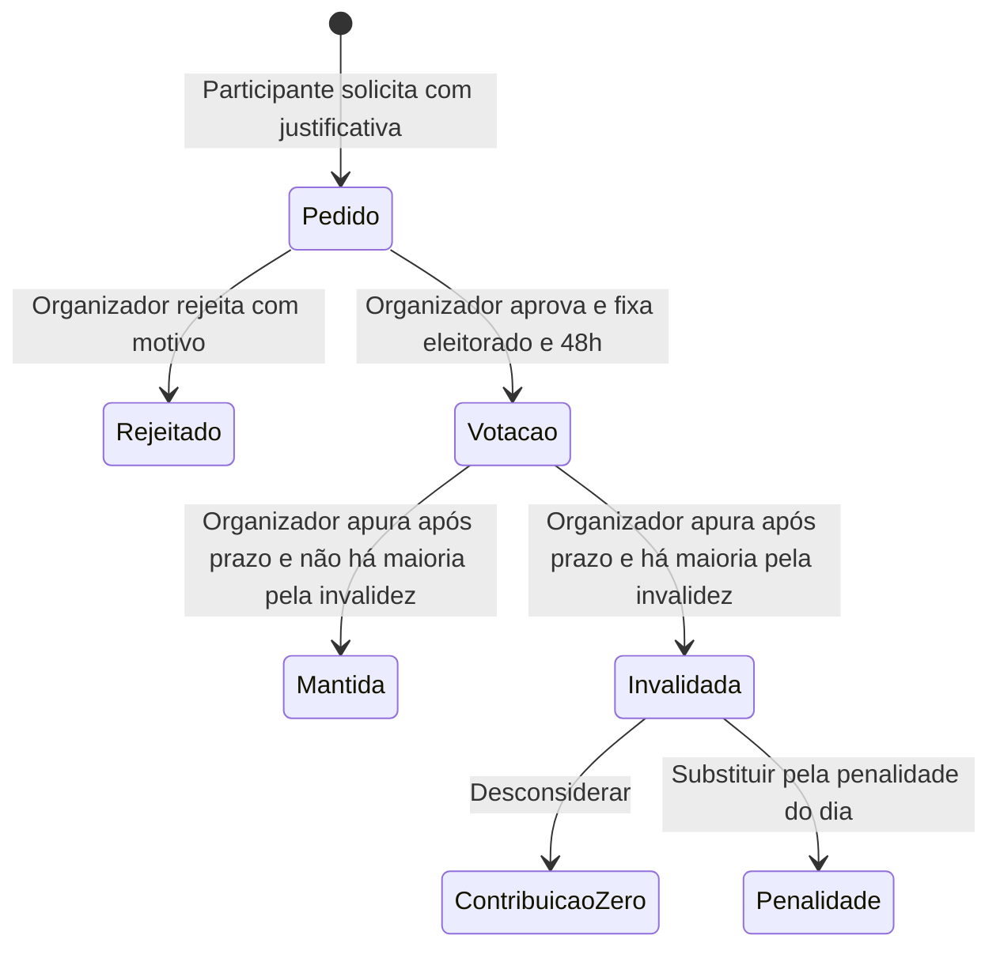
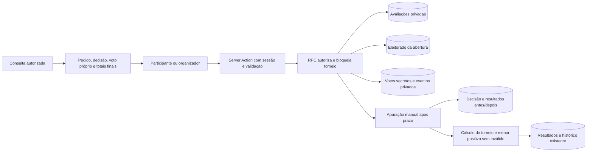

# Auditoria por votação — Sprint 6

Implementação local de 11/10/2026; migração remota pendente. Decisões e restrições na [ADR-006](../decisoes/adr-006-auditoria-por-votacao.md).

A pontuação pessoal original continua compartilhada; decisão usa o par torneio/pontuação. As tabelas privadas não recebem permissões diretas para papéis clientes. Bloqueio do torneio coordena votos, apuração e mutações existentes; encerramento/configuração e alteração do auditado aguardam avaliações pendentes. Correção do bruto em avaliação é bloqueada. A autoria dos demais votos não aparece na projeção nem nos resultados anteriores/posteriores.
