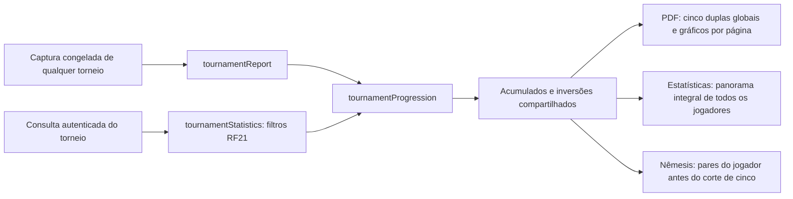

# Estatísticas do torneio — RF21, RF26 e RF27

RF26/RF27 implementados localmente em 31/10/2026, publicação/aceite pendentes. Complementam RF21 e não alteram banco/permissões. [ADR-009](../decisoes/adr-009-estatisticas-do-torneio.md), [ADR-016](../decisoes/adr-016-progressao-acumulada-e-nemesis.md).

```mermaid
sequenceDiagram
    actor Jogador
    participant Painel
    participant Pagina as Página de estatísticas no servidor
    participant Banco as RPC get_tournament_dashboard
    participant Calculo as tournamentStatistics
    participant Nucleo as tournamentProgression
    participant Grafico as CumulativePlot no navegador
    Jogador->>Painel: Selecionar torneio e Estatísticas do torneio
    Painel->>Pagina: Navegar com UUID do torneio
    Pagina->>Pagina: Validar sessão e UUID
    Pagina->>Banco: Consultar torneio com sessão autenticada
    Banco->>Banco: Autorizar e bloquear torneio; refresh existente se aberto
    Banco-->>Pagina: Resultados aplicados completos e hoje em São Paulo
    Pagina->>Calculo: Resultados e identidade da sessão
    Calculo->>Calculo: Somente dias encerrados, elegibilidade e dados válidos
    Calculo->>Nucleo: Participantes e resultados aplicados consolidados
    Nucleo-->>Calculo: Acumulados/posições por data e inversões de todos os pares
    Calculo->>Calculo: Filtrar pares da identidade da sessão; até cinco adversários
    Calculo-->>Pagina: Médias/contagens anteriores, panorama e Nêmesis pessoal
    Pagina-->>Grafico: Somente nomes, próprio, datas e acumulados elegíveis
    Pagina-->>Jogador: Tabela completa e Nêmesis no servidor
    Jogador->>Grafico: Selecionar jogadores, zoom e deslocamento
    Grafico->>Grafico: Ajustar janela e escala localmente; sem consultas/escritas
```

Encerrados retornam resultados armazenados, preservando congelamento. A comparação diária de RF21 mantém valor próprio e média agregada dos demais. O novo panorama RF26 mostra nomes públicos e acumulados identificados de todos os jogadores, expressamente solicitados, sem médias individuais ou dados pessoais externos. RF27 usa somente o jogador da sessão; sem seleção de outro perfil por parâmetro. Retirada continua bloqueando acesso pela RPC. Dados pessoais brutos globais de RF20 permanecem em fluxo separado.



Nenhuma nova RPC, tabela, grant, migração ou escrita. Núcleo puro compartilha as fórmulas; tabela e Nêmesis são componentes de servidor; gráfico interativo é componente de cliente com projeção mínima autorizada. Custos crescem com participantes/datas e comparações de pares; sem benchmark remoto neste incremento.
