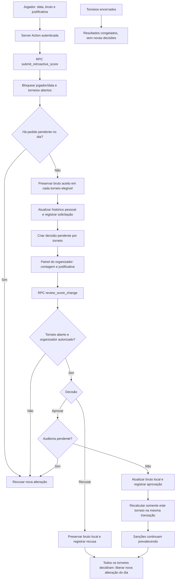
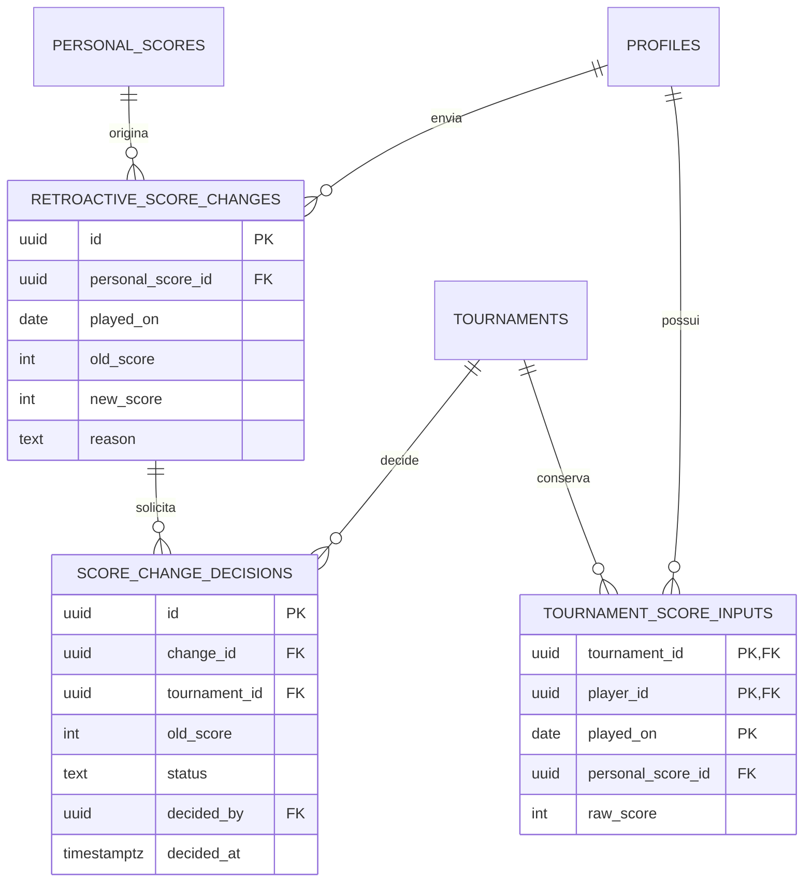

# Lançamentos retroativos

O pessoal muda imediatamente; os torneios usam entradas locais explícitas até decisão. Sem linha local, o cálculo usa o pessoal. Nenhuma alteração é propagada aos resultados armazenados de encerrados. Pedidos pendentes bloqueiam encerramento e revisão de configuração/eligibilidade correspondente. A representação de envio e decisão são duas transações distintas; dentro de cada uma, suas escritas são atômicas.

`old_score` e `raw_score` podem ser NULL para representar ausência anterior; `new_score` é obrigatório. A decisão conserva bruto anterior por torneio, enquanto a solicitação conserva bruto anterior pessoal. `decided_by` referencia o perfil responsável e só existe após a decisão. As tabelas novas ficam no schema privado.
