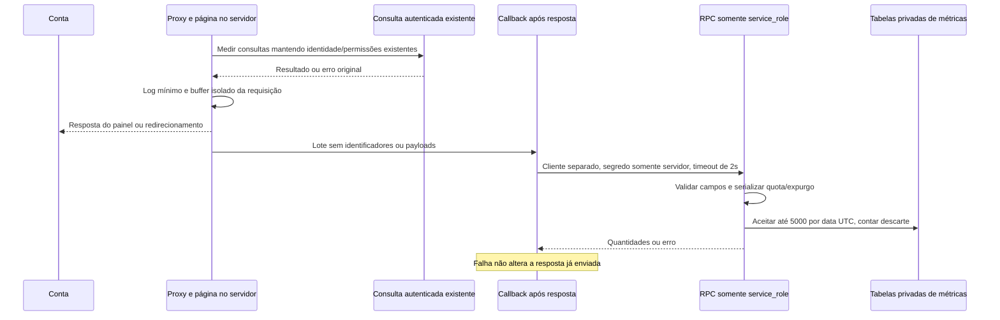
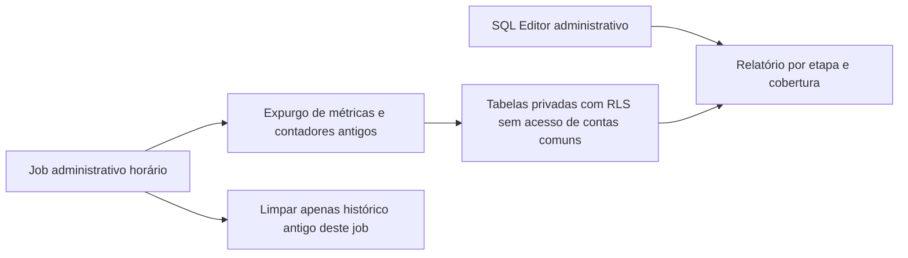

# Coleta operacional — RF24 / S7-05

Implementação local; [ADR-010](../decisoes/adr-010-metricas-operacionais.md). Sem coleta remota ativa confirmada.

Retenção de 14 datas UTC, teto de 70.000 eventos e até 14 contadores. Sem nova UI, coleta de cliques, identificação de jogadores, alteração de ranking ou acesso de organizadores comuns aos relatórios. Migração e ativação são etapas distintas.
