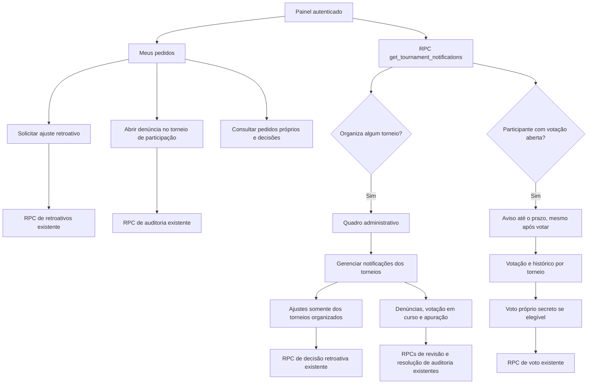

# Pedidos, notificações e votações

O resumo lê as tabelas de estado e não recalcula rankings. Consultas pessoais e administrativas filtram antes da paginação no banco. O quadro administrativo não aparece a contas sem torneios organizados; o aviso de votação depende da participação atual, e a permissão de voto também exige o eleitorado fixado na abertura. Vencido o prazo, a votação deixa de ser oferecida ao participante e vira apuração pendente para o organizador. Nenhum novo armazenamento de notificações ou mudança no modelo de pontuação da ADR-011.
