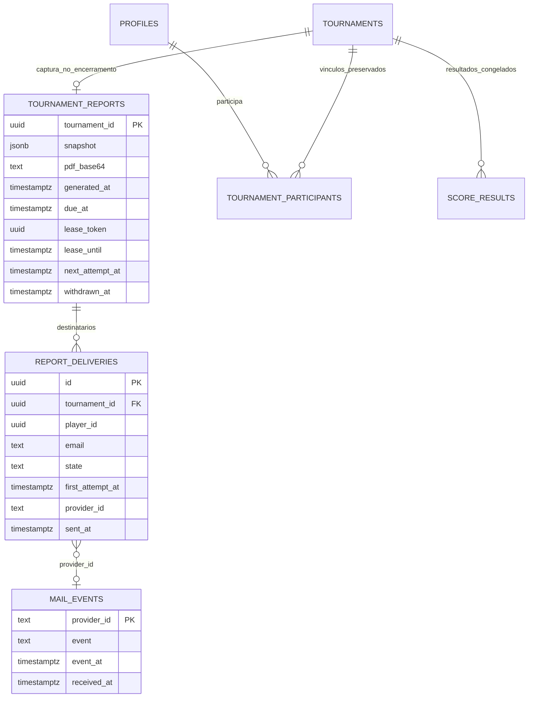

# Sprint 8 — relatório final e retirada

Versão Gmail local em 24/10/2026, conforme ADR-014. Migração inicial instalada/comparada; incremento SMTP e ativação remota ainda pendentes. A tabela MAIL_EVENTS pertence ao desenho legado Resend, sem novas escritas no fluxo atual. Complementa o [modelo existente](classes.md), sem alterar pontuações pessoais ou fórmulas dos torneios.



Esquema `private` nas três entidades novas; `provider_id` é associação operacional, sem FK para aceitar evento anterior à resposta do envio. Snapshot/PDF e endereços tornam-se nulos na retirada. Os registros originais do torneio permanecem internos, sem visibilidade pelas contas da aplicação.

```mermaid
sequenceDiagram
  actor O as Organizador
  participant A as Next.js
  participant DB as PostgreSQL
  participant P as Gmail SMTP
  participant C as Cron / pg_net
  O->>A: Encerrar pelo fluxo existente
  A->>DB: close_tournament
  Note over DB: Mesma transação: bloquear pendências, recalcular,<br/>congelar, capturar dados e destinatários
  DB-->>A: Encerrado + fila durável
  A->>DB: claim com token e lease
  A->>A: Gerar PDF com classificação, evolução e duplas
  A->>DB: Persistir PDF antes de enviar
  loop Até cinco destinatários por execução
    A->>P: E-mail individual + PDF por SMTP/TLS
    P-->>A: Aceitação positiva do envio para o destinatário
    A->>DB: sent + Message-ID (encaminhamento aceito)
  end
  C->>A: A cada cinco minutos: recuperar fila (bearer)
  alt PDF gerado + todos os envios aceitos pelo Gmail
    O->>DB: Retirada antecipada via ação autenticada
    C->>DB: A cada minuto: retirar vencidos há 168h
    Note over DB: Marcar withdrawn_at; limpar PDF/captura/endereços;<br/>RLS e consultas privilegiadas ocultam torneio
  else Pendência ou envio incerto
    Note over DB: Preservar encerrado e bloquear toda retirada
  end
```

Sem webhook de entrega. Timeout/resultado incerto bloqueia retirada e repetição automática; Message-ID não é garantia de deduplicação SMTP. Falhas comprovadas antes de submeter ou rejeições explícitas permitem nova tentativa. Rotas técnicas têm autenticação própria; o tema continua independente do envio/PDF. [ADR-014](../decisoes/adr-014-relatorios-gmail-sem-custo.md).
